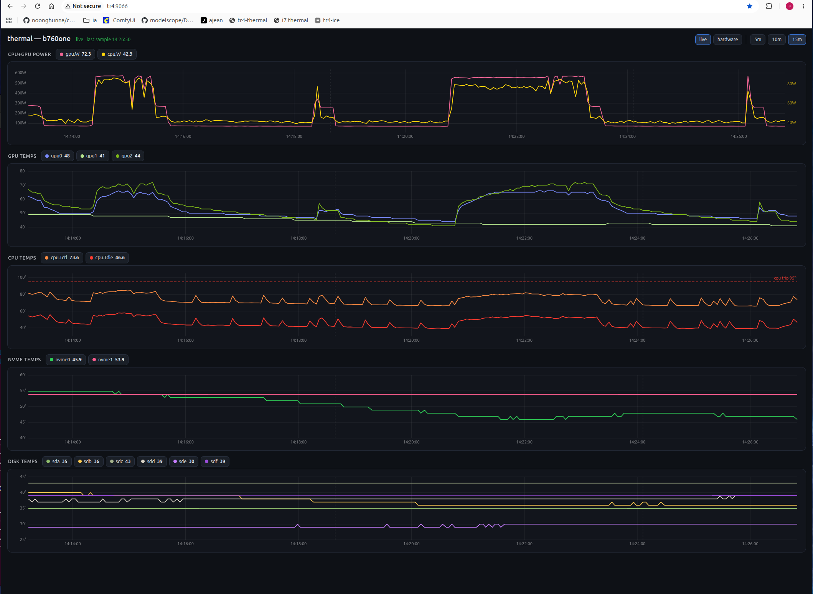
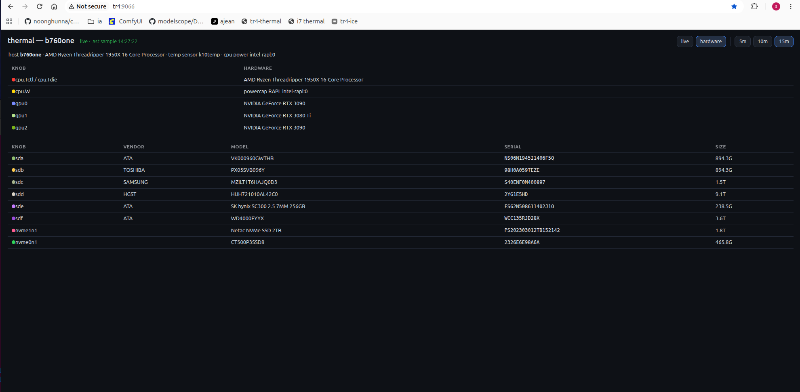

# tempmon — thermal monitor (daemon + web graph)

Built 2026-10-21. Purpose: forensics for b760one/tr4 (192.168.0.30, AMD 1950X)
repeated hard-power-loss reboots — log all temps + power draw every 3 s so the
last 15 min survive for post-mortem, and graph them on the LAN. The dashboard
names itself `thermal-<hostname>` (real hostname, not hardcoded).

## Screenshots

Live tab:


Hardware tab:


## Contents
- `thermal-daemon` — POSIX sh logger: cpu (AMD k10temp / Intel coretemp —
  fields stay cpu.Tctl=package/control, cpu.Tdie=die/core0), cpu power
  (powercap RAPL "package-*" zone, energy_uj delta between samples → cpu.W;
  works on AMD too — the kernel exposes intel-rapl:0 named package-0),
  gpu (nvidia-smi temps per GPU + power.draw summed over all GPUs → gpu.W),
  every real SATA disk from lsblk (0B phantom entries like empty USB
  card-reader slots are skipped; smartctl, needs root), nvme (sysfs hwmon)
  every 3 s → /var/log/thermal.log; fields are dynamic — one per detected
  GPU / disk / NVMe, only sources present on the host. At startup it also
  writes the knob->device hardware inventory (THERMAL_HW_FILE, default
  /var/lib/thermal/hardware.json) for the web "hardware" tab. Self-rotates
  ×2 (last 15 min); start/stop/rotate markers (start marker lists sources
  incl. the powercap zone).
  Test hooks: THERMAL_LOG / THERMAL_HW_FILE / THERMAL_INTERVAL / THERMAL_ROTATE_EVERY.
- `thermal-daemon.service` — systemd unit (Restart=always, runs as root for smartctl).
- `thermal-graph` — stdlib-only Python (ThreadingHTTPServer), zero CDN;
  `/` dashboard with a "live" tab (stacked canvas panels: cpu+gpu power
  (dual-axis: gpu.W left, cpu.W right) / gpu temps / cpu temps (trip line)
  / nvme temps / disk temps — W on the power panel, ° on the temp ones)
  and a "hardware" tab (tables mapping every knob to the device behind it:
  gpu0 = "NVIDIA GeForce RTX 3090", sda = vendor/model/serial/size, cpu and
  cpu.W sources), built from whatever the daemon actually logs — a source
  this host doesn't have (no NVMe, 2 GPUs instead of 3, disks named beyond
  sdf) simply has no chips and no panel. + `/api/data` + `/api/hardware`
  JSON. Env: THERMAL_WEB_HOST (0.0.0.0), THERMAL_WEB_PORT (9066),
  THERMAL_WEB_TRIP_C (cpu trip line), THERMAL_HW_FILE.
- `thermal-graph.service` — systemd unit (Restart=always, enabled).
- `thermal.txt` — post-mortem inspection notes (what to look for after a death).
- `install.sh` — one-shot installer (Debian/Ubuntu, root): installs
  **smartmontools** (disk temp retrieval), the two programs and their units,
  enables + restarts both services, optionally opens the port via ufw, and
  prints the first samples. Everything auto-configures from hardware:
  disks / GPUs / NVMe / RAPL zone are detected at daemon start, and the CPU
  trip temperature is auto-detected from the CPU hwmon driver (k10temp/AMD
  → 95, coretemp/Intel → 100) unless --trip is given.

## Deployed copies
- b760one (192.168.0.30) — live at /usr/local/sbin/{thermal-daemon,thermal-graph}
  + /etc/systemd/system/*.service; reinstalled 2026-10-21 with the generic
  + hardware-tab build, verified (15 API series, /api/hardware with 3 GPUs
  + 8 disks, page 200).
- i7 (192.168.0.33) — live, current (reinstalled 2026-10-21; install.sh
  auto-detected trip 100 from coretemp): dynamic title `thermal-i7`,
  12 SATA disks (6 zero-size USB card-reader phantoms skipped), 2 GPUs
  (gpu0 = RTX 4080 SUPER, gpu1 = RTX 4060 Ti — no gpu2 chip), no NVMe so
  the nvme panel is absent entirely, trip 100, /api/hardware lists all
  12 disks with vendor/model/serial.

## Install on a fresh box
```
sudo sh install.sh [--trip C] --lan <viewer-ip> [--lan <viewer-ip> ...]
```
- `--trip C` — CPU trip temperature for the dashed line on the cpu panel.
  Without it: auto-detected from the CPU hwmon driver (k10temp/AMD → 95,
  coretemp/Intel → 100). Written into the graph unit as THERMAL_WEB_TRIP_C.
- `--lan IP` (repeatable) — source-restricted ufw rule for the dashboard port;
  only applied when ufw is active (with inactive ufw the port is simply open).
  Without any --lan the script prints the ufw command to run.
- Works on AMD (k10temp) and Intel (coretemp) CPUs; missing sources (no GPU
  driver, no NVMe, disks without a temp attribute) just read NA.
- cpu.W appears when the kernel exposes a powercap RAPL zone named package-*
  (modern Intel; verified on the AMD 1950X). No such zone → field omitted,
  installer prints a note; everything else unaffected.

Manual install (no script):
```
sudo apt-get install -y smartmontools      # disk temp retrieval (smartctl)
sudo cp -a thermal-daemon thermal-graph /usr/local/sbin/
sudo cp -a thermal-daemon.service thermal-graph.service /etc/systemd/system/
sudo systemctl daemon-reload
sudo systemctl enable --now thermal-daemon thermal-graph
```

## Firewall (source-restricted to the two viewers)
```
sudo ufw allow from 192.168.0.33  to any port 9066 proto tcp   # i7  (Linux boot)
sudo ufw allow from 192.168.0.100 to any port 9066 proto tcp   # ak  (Windows boot)
```
Note: ak and i7 are ONE physical dual-boot machine — only one IP is up at a
time; both rules are needed so whichever boot is live can open the dashboard.

## Watch for (after next sudden shutdown)
- journalctl --list-boots — abrupt end = hard power loss
- /var/log/thermal.log + .1/.2 — cpu.Tdie approaching 95 °C (1950X trip),
  a temp spike, or samples simply stopping (no "daemon stop" marker).
